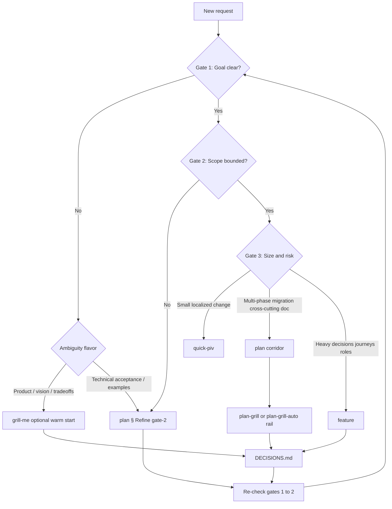

# Skill router

Use this file to pick **one primary skill** (sometimes two in sequence).

**Invocation contract (always):** After you decide the primary skill — and any secondary skill that must run **next** in order — **read that skill’s `SKILL.md` and execute its workflow starting in this same turn.** Invoking means load + follow steps, not naming a path or asking the user which skill file to open. If two skills apply sequentially (for example `plan` → `implement`), finish the first’s applicable step or hand off explicitly per that skill, then read and run the second without ending on a static routing table alone.

**Fan-out exception (subagents):** When the chosen next skill spawns parallel subagents (`review-dev-plan`, `validate`, `improve-skill-library`, …) and the user did not invoke it by name, **offer** it with one line instead of starting it. Direct invocation (`/validate`, "run review-dev-plan") counts as the ask. `plan-grill-auto` keeps its own auto-chain.

## `/router` — pick next action + skill

**Purpose:** `/router` means “decide the **most logical next step** for this thread, pick the skill, and **do it**.” The user should not have to name the skill.

**Resolution order (always):**

1. **Thread continuation** — active in-flight work in this conversation (see **Active thread work** below).
2. **Substantive request** — user message names a task, question, or change → **Decision model** gates + **Situation → skill** (skip backlog).
3. **Backlog intake** — only when step 1 finds **no** active thread work **and** the message is bare `/router` or equivalent idle dispatch (see **App task backlog**).

**Bare `/router`:** Message is only `/router` (optional whitespace) with **no substantive task or question**. Run step 1 first; if no active thread work, fall through to backlog intake. This is **not** `finish` and **not** “commit the working tree” unless thread continuation clearly left off at validated, landing-ready work **and** the user’s prior turn signaled wrap-up (otherwise prefer `validate` or the next implement phase — do not auto-commit).

**On continuation:** Briefly state one line — `Next: [action] → \`skill\`` — then read and run that skill. Do not re-run full backlog selection or restart gates 1–2 when the thread already has a bounded active job.

### Active thread work

Treat the thread as **mid-task** when **any** of these hold:

| Signal | Examples |
|--------|----------|
| **Conversation** | Recent turns executing `implement`, `quick-piv`, `feature`, `debug`, `grill-me`, `plan-grill`, or `plan` § Refine on a specific job; quick plan posted but implement/validate not done |
| **Open / recent files** | `documentation/jobs/temp_job_*/DEVELOPMENT_PLAN.md` or `DECISIONS.md` tied to the current job |
| **Plan state** | Active plan has pending phases, `Plan review: Required: pending`, `Plan validate: Required: pending`, or incomplete **Pattern & precedent** when M/L requires it |
| **Working tree** | `git status` shows changes that match the thread’s stated scope (same job/files discussed) |

**Not** active thread work: new or idle chat; prior job explicitly completed in thread; user clearly changed topic; only unrelated uncommitted files with no in-thread narrative.

**Context gather (step 1):** Skim recent thread; note open/recent job paths; run `git status -sb` when the tree may inform the next step; load the active `DEVELOPMENT_PLAN.md` when one applies.

### Thread → next skill (mid-task)

Pick **one** primary by the **most blocking** row that applies (top wins). Then invoke it.

| Thread state | Next skill |
|--------------|------------|
| Active `debug` incident; root cause unknown | `debug` |
| `feature` phase incomplete | `feature` |
| Gates 1–2 still fail **on the current job** | `grill-me` (gate 1 / optional warm start) or `plan` § Refine (gate 2). IF already inside `plan` corridor THEN product/scope forks → `plan-grill` rail (not a new standalone `grill-me`). IF user forbids questions THEN `plan-grill-auto` (not `grill-me`). |
| Plan exists; **Plan review** pending (M/L) | `review-dev-plan` |
| Plan exists; **Plan validate** pending (M/L) | `validate` (plan-review) — before `implement` |
| Plan exists; **Pattern & precedent** missing when required | `pattern-review` (`plan-section`) or resume `plan` |
| Plan exists; pending phase(s) | `implement` |
| Plan exists; XS/S in-thread extension only | `quick-piv` |
| No plan file; quick plan in chat; implement/validate incomplete | `quick-piv` |
| All planned phases done; full audit not yet run | `validate` |
| Validated; user/thread signaled landing | `finish` (only when wrap-up is the clear next step — not the default for bare `/router` on new work) |
| Pushed; CI status unknown | Per `.cursor/rules/git-workflow/RULE.mdc` § Mode behavior table → **CI watcher** (A: babysit the PR; B: report the commit URL and stop; C: desktop app PR monitor). Do not `gh run watch`. CI is GitHub Actions after the push |

Align with [dev-cycle matrix](references/dev-cycle-matrix.md). IF active job AND repo/branch context unknown THEN run **`prime`** once, then continue with the chosen skill — do not replace thread continuation with backlog intake.

**`/finish`** is only for explicit wrap-up — read `.agents/skills/finish/SKILL.md` when the user invokes finish or asks to commit completed work (not the default idle `/router` outcome).

**Quality bar:** Listed skills were reviewed for actionable structure (clear triggers, steps, or rubrics).

---

## Decision model: goals + requirements → skill

For **new or substantive** requests — and after **Active thread work** is ruled out — route in **three gates**. Answer in order; **do not skip gate 1 or 2** to reach `plan` or `implement`. When the thread is **mid-task**, use **Thread → next skill** instead of restarting gates unless the user explicitly changes scope.

### Gate 1 — Goal / outcome

**Question:** Can you state what “done” means in one sentence, with something verifiable (demo, test, or checklist)?

| State | Meaning |
|-------|---------|
| **Clear** | Intended behavior or artifact is agreed; success is falsifiable. |
| **Unclear** | Wish or direction only; conflicting interpretations possible; “make it better” with no bar. |

If unclear, ask about the user's intended app usage, product vision, priorities, or real user journey. **First read** `documentation/DOC_APP_VISION.md` when it may already answer “who / why / what the app is for”; if it is still **`DRAFT`**, route the user to complete it (`.agents/skills/start/SKILL.md` § App vision) or treat lack of vision as ambiguity until they defer in writing. Do not route into full planning until the answer removes ambiguity.

**Bug reports** (error, broken behavior, regression — not a feature request): route to **`debug`** (§ Chat intake) before `implement` or `quick-piv`, even when gate 1 sounds “clear” on the symptom alone.

### Gate 2 — Scope / requirements

**Question:** Is **in-scope vs out-of-scope** explicit enough to choose layers and files without inventing product scope?

| State | Meaning |
|-------|---------|
| **Bounded** | Boundaries, constraints, and “not doing X” are understood (or intentionally left open **only** where documented). |
| **Unbounded** | Missing acceptance hints, unknown data/auth/API shape, or “everything flexible.” |

If the emerging direction would diverge from industry standards, framework best practices, or established repo conventions, ask whether the diversion is intentional or whether to align with best practices before routing to implementation.

**Pre-implementation — name the mechanism (code that adds or copies a symbol):** Before routing to `quick-piv`, `plan`, `implement`, or direct code, read and follow [`.agents/skills/name-the-mechanism/SKILL.md`](../name-the-mechanism/SKILL.md) whenever the change adds or copies a function, hook, component, type, file, or feature folder. This includes a one-line edit, a one-off, a second copy, and a third or later copy. Do not defer it to `optimize2`. It runs even when layer-consistency cues do not match.

**Pre-implementation — layer consistency (when cues match):** Before routing to `quick-piv`, `plan`, or direct code, check request-side cues in [`layer-consistency-check/references/workaround-shapes.md`](../layer-consistency-check/references/workaround-shapes.md) § Request-side cues — including **any change to existing behavior** (verify the user's assumption about how the system works first) and the onboarding-UI cue for integrations whose SSOT is `.env` + `src/config/app-tasks.json` + docs. If cues match, read and run [`.agents/skills/layer-consistency-check/SKILL.md`](../layer-consistency-check/SKILL.md) **first** — do not explore for implementation until the one-beat check clears or the user picks workaround vs structural path. Name-the-mechanism still applies to any new or copied symbol in that change.

### Gate 3 — Delivery shape (only after gates 1–2 pass)

**Question:** How big and how risky is the **engineering** change?

| Signal | Typical skill |
|--------|----------------|
| Single area, few files, no migration / no breaking API | `quick-piv` |
| Multiple phases, migrations, cross-cutting rules, or durable handoff doc | `plan` → `implement` |
| Dense product decisions, journeys, roles, explicit approval checkpoints | `feature` |

### Clarification-first routing (gate 1 or 2 fails)

**Do not open `DEVELOPMENT_PLAN.md` yet** unless the user already invoked `/plan` or plan work has started — then stay in the **plan corridor** and use the **`plan-grill` rail** for product/scope forks (see § Plan corridor flow).

Pick by **what is missing**:

| Missing | Prefer |
|---------|--------|
| Vision, priorities, tradeoffs, UX intent **before** planning | `.agents/skills/grill-me/SKILL.md` (optional warm start → `DECISIONS.md`); ask app-usage questions until ambiguity is removed. IF user forbids questions → `.agents/skills/plan-grill-auto/SKILL.md` instead (no `grill-me`) |
| Product/scope/architecture-boundary fork **during** Refine / Investigate / Create | `.agents/skills/plan-grill/SKILL.md` via `plan` — mandatory fork checklist; anti-dup via `DECISIONS.md`. IF user forbids questions → `.agents/skills/plan-grill-auto/SKILL.md` |
| Concrete behavior, APIs, data, acceptance examples (gate 2) | Follow **Refine** in `.agents/skills/plan/SKILL.md` (gate-2 tables — stop before **Investigate** until gates pass); frame around intended app usage when product meaning is unclear |
| You lack repo grounding while clarifying | `.agents/skills/prime/SKILL.md` **before or mixed with** clarification |

After gates 1–2 pass, **re-run** the flowchart from the top (especially if the user changed scope).

### Plan corridor flow (`grill-me` → ledger → `plan` + `plan-grill` rail)

**Diagram SSOT:** [`references/skill-relationship-flow.md`](references/skill-relationship-flow.md) (sidecar — maintain with `align-harness`).

Canonical shape (do not draw `plan-grill` as a Create-only side quest):

1. **Optional warm start:** IF idea is fuzzy / gate 1 fails on vision-tradeoffs THEN `grill-me` → log Closed rows to `DECISIONS.md`. Skip when the user already has a sharp perimeter.
2. **Plan corridor:** `plan` runs Refine → Investigate → Create.
3. **`plan-grill` rail:** beside **every** corridor phase — before locking a product/scope/architecture-boundary choice, run the fork checklist (enumerate ≥2 options or justify sole option; ask on ties; log clear-winners; never invent-one-and-stamp-winner). Loop: **ask → write `DECISIONS.md` → continue the same phase**. IF user forbids questions → **`plan-grill-auto`** (same checklist; agent-pick; no Present wait; then implement).
4. **Artifacts:** `DECISIONS.md` = product/scope locks (`plan-grill` / `plan-grill-auto` / `feature`); `DEVELOPMENT_PLAN.md` = how to build. Impl-time picks go in plan § Decisions made during `implement`.
5. **M/L:** before Present, ledger must cover every product/scope lock (or explicit `no product forks — <reason>`).
6. **XS / `quick-piv`:** no `plan-grill`.

Skill SSOT for checklist/cues: `.agents/skills/plan-grill/SKILL.md`. Auto-answer variant: `.agents/skills/plan-grill-auto/SKILL.md`.

### Matrix (compact)

Rows = gate 1–2; columns = gate 3 applies only when both are **Clear / Bounded**.

| Goal | Scope | Next step |
|------|-------|-----------|
| Unclear | any | Clarify (`grill-me` and/or `plan` § Refine); optional `prime` |
| Clear | Unbounded | Bound scope (`plan` § Refine); optional `prime` |
| Clear | Bounded | Use flowchart below for `quick-piv` vs `plan` vs `feature` |

### Flowchart

Optional: run **`prime`** once when the codebase or branch context is unfamiliar — it does not replace gates 1–2.

While inside **plan corridor** (`I`), product/scope forks use **`plan-grill` rail** (checklist → ask/log → same phase) — or **`plan-grill-auto`** when the user forbids questions (checklist → agent-pick → same phase → no Present wait). Not a separate pre-plan `grill-me` unless the user leaves plan to re-open gate 1 and is willing to answer.

**Dev-cycle (SSOT):** [`.agents/skills/router/references/dev-cycle-matrix.md`](references/dev-cycle-matrix.md) — full happy path, M/L gates, and plan depth. Do not duplicate that matrix here.

---

## Skill index (situation → skill)

Every project skill is listed below with its trigger situation; open `.agents/skills/<name>/SKILL.md` for the chosen one.

### This repo — workflow & delivery

| Situation | Skill |
|-----------|--------|
| User sends **only** `/router` (no substantive task); see **`/router` — pick next action + skill** | Thread continuation if mid-task; else `app-tasks.json` → `prime` → `grill-me` → `quick-piv` or `plan` |
| New chat / ambiguous task; map repo rules and recent git state | `.agents/skills/prime/SKILL.md` |
| **Goal and scope clear**; non-trivial job needing phased written plan + compliance | `.agents/skills/plan/SKILL.md` |
| Plan written; qualitative critique before implementation (especially Complexity M/L) | `.agents/skills/review-dev-plan/SKILL.md` |
| Industry standard / best practice / “is this how products usually do it?” on a **plan or proposal** | `.agents/skills/pattern-review/SKILL.md` |
| Nontrivial generic subsystem (auth, queues, parsers, webhooks, protocol clients, …) — reuse a package/pattern vs build custom | `.agents/skills/dont-reinvent-the-wheel/SKILL.md` |
| New `src/features/` folder, new UI/data vendor, or “how hard to replace MUI/Vite/Supabase / modularity / stack leakage” | `.agents/skills/modularity-review/SKILL.md` |
| Ambiguous “improve / clean up / make better” on an existing area; `/improve` | `.agents/skills/improve/SKILL.md` |
| Should we align [existing product/feature/component] with industry standards? / how to align? | `.agents/skills/standards-align/SKILL.md` |
| Delete / remove / rip out / `/purge` a named feature/module/path/engine with multi-asset cleanup; leftover engine after a flag-off or replacement phase; "is the old path gone?" | `.agents/skills/purge-skill/SKILL.md` |
| Author or refine one project skill under `.agents/skills/` (`/create-skill`) | `.agents/skills/create-skill/SKILL.md` |
| Add or copy a function, hook, component, type, file, or feature folder; second copy; third or later copy; menu, timer, queue, or layout primitive; placement line, glob, or trigger for that kind of code | `.agents/skills/name-the-mechanism/SKILL.md` **before** the delivery skill (also always-on via `code-style/RULE.mdc` § Naming) |
| Change existing behavior / unverified system assumption / workaround / “just this one” exception during implementation | `.agents/skills/layer-consistency-check/SKILL.md` (also always-on via `architecture/RULE.mdc` § Layer consistency). Naming still follows `name-the-mechanism`. |
| Write a cross-repo adoption guide from an implemented pattern | `.agents/skills/write-adoption-guide/SKILL.md` |
| Goal or scope **not** ready — clarify only (no `DEVELOPMENT_PLAN.md` yet); **one** primary by missing dimension (see **Clarification-first routing**) | Product/vision → `grill-me`; user forbids questions → `plan-grill-auto`; acceptance/APIs → `plan` **§ Refine** only |
| Execute an existing `DEVELOPMENT_PLAN.md` phase by phase | `.agents/skills/implement/SKILL.md` |
| Small scoped change; plan+implement+validate in one pass | `.agents/skills/quick-piv/SKILL.md` |
| Review plan or implementation **without** editing by default; pre-merge / post-refactor gate (auto-selects plan-review / impl-full / gate depth) | `.agents/skills/validate/SKILL.md` |
| Component-level rubric (props, MUI, a11y, tests) | `.agents/skills/review/SKILL.md` |
| Version, changelog, staging gate, **local** commit | `.agents/skills/finish/SKILL.md` |
| Bundle **all** uncommitted work from multiple agent threads (same checkout), then push | `.agents/skills/bundle-ship/SKILL.md` |
| Push already committed work (after `finish`) | `.agents/skills/push/SKILL.md` |
| Bug / error / broken / regression (not a new feature) | `.agents/skills/debug/SKILL.md` — § Chat intake before code |
| Promote `develop` staging to production (`main`) | Pre-promote check + `gh workflow run promote-to-production.yml` — `.cursor/rules/git-workflow/RULE.mdc` § Promote to production (not `finish`, not a squash PR). On ancestor failure → reconcile on `develop` there, then re-run |
| User asks to PR / merge `develop` → `main`, **land on main**, or "release to production" (colloquial) | **Same as promote** — pre-promote check, then workflow; **never** `gh pr create --base main --head develop` |
| Human onboarding; README quick start + dev task backlog | `.agents/skills/start/SKILL.md` (includes **App vision** gate → `documentation/DOC_APP_VISION.md`) |

### This repo — product & codebase shape

| Situation | Skill |
|-----------|--------|
| Full feature request with mandatory decision stops and phased spec | `.agents/skills/feature/SKILL.md` |
| Scientific debugging; hypotheses; user supplies runtime evidence | `.agents/skills/debug/SKILL.md` |
| Pre-registered hypothesis loop; naive fixes failed or user invokes hypothesis mode | `.agents/skills/hypothesis/SKILL.md` |
| Ultra-compressed communication (`/caveman`, "be brief", "less tokens") | `.agents/skills/caveman/SKILL.md` (overlay — not a workflow step) |
| Stress-test product/design when gates 1–2 already pass (not gate-1 ambiguity); optional warm start before plan | `.agents/skills/grill-me/SKILL.md` |
| Product/scope fork during plan corridor (Refine/Investigate/Create); `/plan-grill`; **rail invoked by `plan`** — mandatory checklist | `.agents/skills/plan-grill/SKILL.md` |
| Same rail, user forbids questions (`/plan-grill-auto`, "answer yourself", "don't ask me", "I won't check, only test") | `.agents/skills/plan-grill-auto/SKILL.md` — agent picks; writes `DECISIONS.md`; no Present wait |
| Simplify **one** concrete feature (flows + code), reduce steps/complexity | `.agents/skills/challenge/SKILL.md` |
| Find duplication in a **named target** (folder, feature, layer, glob) or whole `src/` if asked; consolidation candidates; semantic placement (after tooling is green) | `.agents/skills/consolidate/SKILL.md` |
| Optimize hotspots: design → approach → efficiency → complexity | `.agents/skills/optimize2/SKILL.md` |
| React perf patterns (bundle, waterfalls, re-renders) for Vite SPA | `.agents/skills/react-perf-vite/SKILL.md` |
| Retro from failures/diffs; persist lessons into rules or skills | `.agents/skills/learn/SKILL.md` |
| Audit/improve the **agent harness** (AGENTS, rules, skills, INDEX, layers); subagent lenses + no-loss pass | `.agents/skills/align-harness/SKILL.md` |
| Intake **external** harness content from `.agents/harness-inbox/` | `.agents/skills/update-harness/SKILL.md` |
| Tighten / prune / de-bloat harness context (CLAUDE.md, AGENTS.md, rules, skills); token cost of always-loaded instructions | `.agents/skills/tighten-harness/SKILL.md` |
| Grade **or** improve an attached rule/command file (rubric score and/or quality rewrite) | `.agents/skills/rule-quality/SKILL.md` |

### This repo — integrations

| Situation | Skill |
|-----------|--------|
| Research/integrate an external API or backend (MCP-first, schema→sample discipline) | `.agents/skills/api-integrate/SKILL.md` |

### User-level Cursor skills (`~/.cursor/skills-cursor/`)

| Situation | Skill |
|-----------|--------|
| Author or refine a project skill under `.agents/skills/` | `.agents/skills/create-skill/SKILL.md` (this repo SSOT; `~/.cursor/skills-cursor/create-skill` is reference-only here) |
| Migrate `.mdc` rules / slash commands → skills | `~/.cursor/skills-cursor/migrate-to-skills/SKILL.md` |
| Create `.cursor/rules` `.mdc` guidance | `~/.cursor/skills-cursor/create-rule/SKILL.md` |
| Cursor hooks (`hooks.json`, hook scripts) | `~/.cursor/skills-cursor/create-hook/SKILL.md` |
| Custom subagents | `~/.cursor/skills-cursor/create-subagent/SKILL.md` |
| PR merge-ready loop (comments, conflicts, CI) | `~/.cursor/skills-cursor/babysit/SKILL.md` |
| Split work into small PRs | `~/.cursor/skills-cursor/split-to-prs/SKILL.md` |
| Standalone analytical UI artifact (`.canvas.tsx`) | `~/.cursor/skills-cursor/canvas/SKILL.md` |
| IDE `settings.json` | `~/.cursor/skills-cursor/update-cursor-settings/SKILL.md` |
| CLI `~/.cursor/cli-config.json` | `~/.cursor/skills-cursor/update-cli-config/SKILL.md` |
| CLI status line | `~/.cursor/skills-cursor/statusline/SKILL.md` |
| User typed `/shell` — run remainder literally | `~/.cursor/skills-cursor/shell/SKILL.md` |

### Plugin skills (paths vary by install; discover under `~/.cursor/plugins/`)

| Situation | Skill (name) |
|-----------|----------------|
| Any Supabase product (Auth, DB, Edge, Realtime, Storage, MCP, migrations) | `supabase` |
| Postgres query/schema performance, pooling, RLS performance | `supabase-postgres-best-practices` |
| Cloudflare platform routing (“what product do I use?”) | `cloudflare` |
| Wrangler CLI commands and config | `wrangler` |
| Workers code author/review, anti-patterns | `workers-best-practices` |
| Durable Objects design/review | `durable-objects` |
| Agents SDK reference-heavy agent work | `agents-sdk` |
| Generate/deploy AI agent app on Cloudflare | `building-ai-agent-on-cloudflare` |
| Remote MCP server on Workers | `building-mcp-server-on-cloudflare` |
| Untrusted code execution / sandbox | `sandbox-sdk` |
| Core Web Vitals / Lighthouse-style audit (Chrome DevTools MCP) | `web-perf` |

---

## When more than one skill seems relevant

Choose by **primary outcome** (what must be true when done). If two outcomes are required, run skills **in order** (e.g. plan → implement → validate → finish). Use **Decision model** above first: neither `plan` nor `feature` should start until gates 1–2 pass (unless you are intentionally only running **`plan` § Refine** or **`grill-me`**).

Pairwise tiebreaks and ordered pipelines (plan review stack, `dont-reinvent-the-wheel` → `api-integrate` → `pattern-review`, `layer-consistency-check` before `pattern-review`, `web-perf` → `optimize2` → `react-perf-vite`, …): [`references/tiebreaks.md`](references/tiebreaks.md).

**Always-on:** name-the-mechanism is enforced during implementation via `code-style/RULE.mdc` § Naming and the pre-implementation gate above; layer-consistency via `architecture/RULE.mdc` § Layer consistency — not only when the user names those skills.

### Routing state rules

#### Thread continuation vs backlog intake

- **Thread continuation:** Mid-task `/router` — resume the active job via **Thread → next skill**; do not read `app-tasks.json` first.
- **Backlog intake:** Idle thread + bare `/router` — pick from `app-tasks.json` per **App task backlog**.
- **Conflict:** If thread work and backlog `in-progress` disagree, **thread wins** unless the user explicitly asks to switch tasks.

#### Bare `/router` vs `finish`

- **Bare `/router`** (no task text): **next-action dispatch** — **Active thread work** first; only when idle, **backlog intake** from `src/config/app-tasks.json`. **Not** default `finish` on new/idle dispatch.
- **`/finish`:** explicit wrap-up — includes archiving the session task when applicable (see `finish` skill). Not the default for idle `/router`.

#### App task backlog (SSOT)

- **Active:** `src/config/app-tasks.json` (`to-do` | `in-progress` only; array order = priority).
- **Archive:** `src/config/app-tasks-archive.json` (`done` only; append order = completion timeline). **Do not read** unless the user asks for completed history.
- **Coding agent pick up:** when the assistant **commits to execute** a backlog task, set `in-progress` in the active file **in the same turn** before `prime`, `grill-me`, `plan`, or code. User edits in `/tasks` UI do **not** trigger pick-up.
- **Onboarding tasks:** Fresh clones ship five seeded tasks (Supabase, Hosting, App vision, Airtable optional, Theme). Agents sync status at session boundaries per `start`, `router`, and `finish` — edit JSON directly or via `/__dev/tasks` when dev server runs. Disk-wins on UI conflicts.
- **Backlog intake** (fallback only — after **Active thread work** is ruled out):
  - Read only `src/config/app-tasks.json`.
  - If `in-progress` exists: ask continue that task vs first `to-do` by list order.
  - Else select first `to-do` by list order.
  - Apply pick up for the chosen task (skip if already `in-progress`).
  - Then `prime` (if needed) → `grill-me` unless `title` + `description` satisfy gates 1–2 → `quick-piv` or `plan` / `feature` per gate 3.
- If no actionable `to-do` or `in-progress`: say so; optional `prime` for repo context — do **not** invent tasks and do **not** default to `finish`.

---

## Router references (not skills)

- `.agents/skills/router/references/dev-cycle-matrix.md` — dev-cycle happy path and M/L gates (SSOT)
- `.agents/skills/router/references/skill-relationship-flow.md` — grill / plan corridor / plan-grill rail diagram (SSOT; `align-harness` maintains; includes `plan-grill-auto`)
- `.agents/skills/router/references/tiebreaks.md` — pairwise skill tiebreaks and ordered pipelines

## Not present in this workspace

The agent inventory may list skills that are **not** checked into this repo (e.g. generic architecture/TDD/issue PRD skills). If absent on disk, substitute **`plan` / `consolidate` / `validate`** or add a project skill before relying on them.
